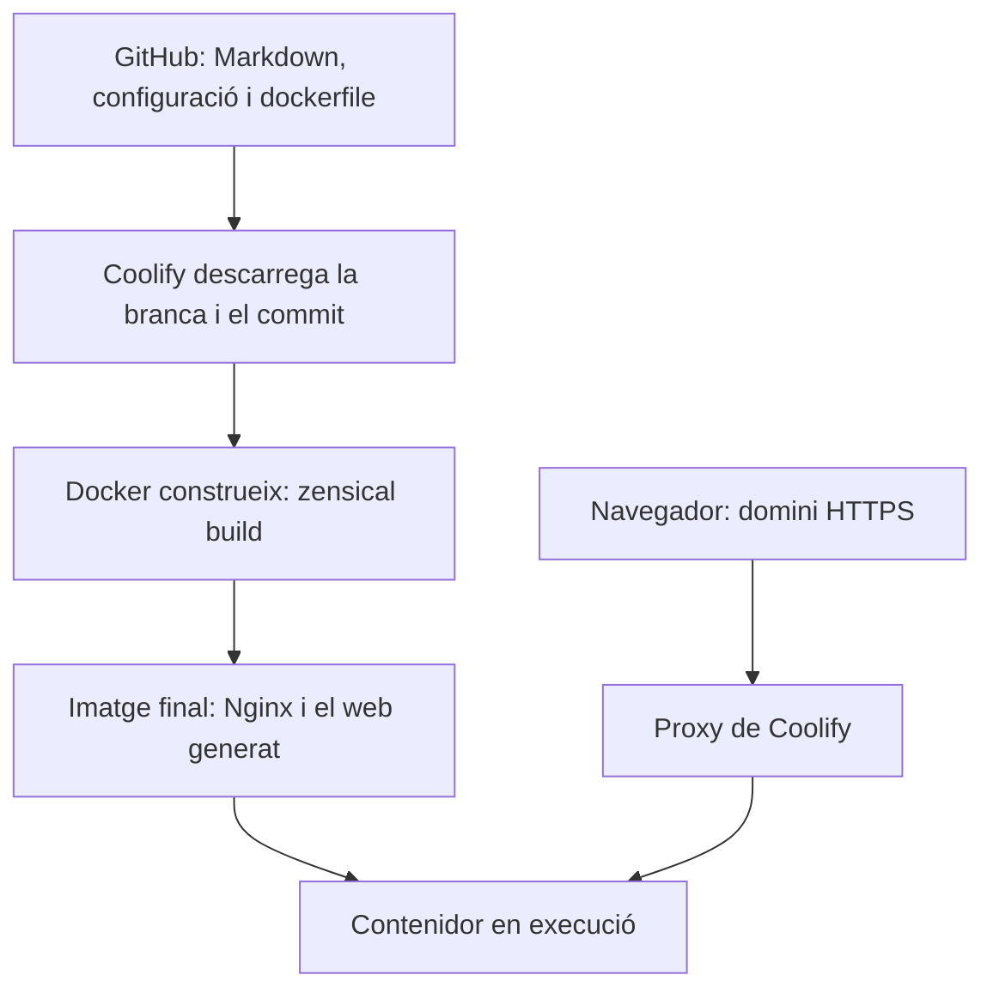

# Entendre com funciona Coolify

Coolify coordina la publicació: obté el codi, construeix o descarrega una imatge, crea el contenidor i configura com arribar-hi. El servidor aporta CPU, memòria i disc; diverses aplicacions comparteixen aquests recursos.

## Projectes, entorns i recursos

| Nivell | Funció | Exemple real |
| --- | --- | --- |
| **Projecte** | Agrupa una iniciativa o un conjunt de desplegaments relacionats. | `MainStatic` |
| **Entorn** | Organitza els recursos segons l’ús. | `production` |
| **Recurs** | Aplicació, base de dades o servei desplegat. | `garage_landing_page:main` |

```text
MainStatic
└── production
    └── garage_landing_page:main
```

Per començar n’hi ha prou amb l’entorn assignat. Més endavant pots afegir `staging` per a proves, amb una altra branca i un altre domini.

!!! note "Un entorn no és un servidor nou"

    Dos entorns poden compartir el VPS i la seua capacitat. Crear-ne un no copia automàticament les dades ni la configuració de producció.

## Del document al web publicat

En el nostre exemple:



| Concepte | Explicació |
| --- | --- |
| **Repositori** | Fitxers i historial de canvis allotjats, en l’exemple, a GitHub. |
| **Branca** | Línia de treball del repositori, com `main`. |
| **Commit** | Revisió concreta del codi que queda identificada en el desplegament. |
| **Build o construcció** | Procés que prepara la imatge; ací també genera HTML amb Zensical. |
| **Dockerfile** | Recepta per construir una imatge. |
| **Imatge** | Paquet preparat per executar l’aplicació. |
| **Contenidor** | Instància en execució d’una imatge. |
| **Desplegament** | Operació que posa en servei una versió del recurs. |
| **Logs o registres** | Missatges per entendre què passa o localitzar errors. |

Zensical genera els fitxers; Nginx els serveix. No necessitem deixar `zensical serve` en funcionament al VPS.

## Font del codi i mètode de construcció

Són decisions diferents:

| Decisió | Pregunta | Resposta de l’exemple |
| --- | --- | --- |
| **Font** | D’on obtenim els fitxers? | Repositori públic de GitHub. |
| **Build pack** | Com preparem la imatge? | Amb el `dockerfile` del repositori. |

Un Dockerfile també es pot introduir sense Git, però llavors no disposa dels fitxers del repositori per copiar-los amb `COPY`.

**Web estàtic** descriu el resultat que rep el navegador. **Static**, al selector de construcció de Coolify, és un mètode per a fitxers ja generats. El nostre web és estàtic, però el construïm amb Dockerfile perquè parteix de Markdown.

## Dominis i ports

El DNS relaciona el domini amb el servidor. El proxy de Coolify rep les peticions i les envia al contenidor correcte segons el domini.

| Connexió | Port de l’exemple |
| --- | --- |
| Navegador → proxy, amb HTTPS | Públic `443` |
| Proxy → Nginx | Intern `80` |
| Prova local: navegador → Docker | Local `8080` redirigit a l’intern `80` |

Diversos contenidors poden escoltar cadascun al seu port intern 80. El proxy diferencia els webs pels dominis. [Domini, DNS i HTTPS](dominis.md) explica la configuració.

## Quan necessitem volums?

La imatge del nostre web ja incorpora el contingut generat: no necessita volums. Per actualitzar-lo, construïm una imatge amb els documents nous.

Una aplicació que guarda fitxers pujats per usuaris necessita **emmagatzematge persistent** perquè aquestes dades sobrevisquen a la substitució del contenidor. Els muntatges es poden configurar a Coolify encara que es construïsca amb Dockerfile; amb Compose es declaren en la definició Compose. El repositori no es converteix automàticament en un volum.

Una base de dades també necessita planificar persistència i còpies de seguretat. Un volum conserva dades, però no substitueix una còpia de seguretat.

Referències: [conceptes de Coolify](https://coolify.io/docs/concepts), [Dockerfile](https://coolify.io/docs/applications/builds/dockerfile) i [emmagatzematge persistent](https://coolify.io/docs/applications/configuration/persistent-storage).
