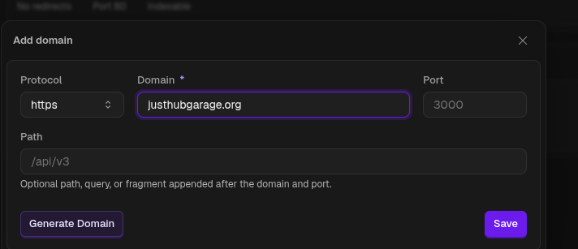
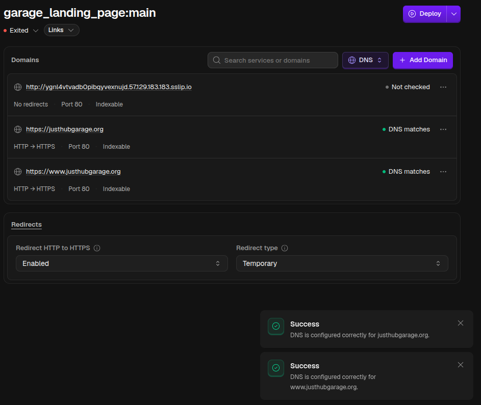

# Domini, DNS i HTTPS

El **DNS** dirigeix el nom al servidor. El **proxy de Coolify** dirigeix la petició al recurs correcte dins del servidor.

```text
Navegador → DNS: localitza el servidor
          → Proxy de Coolify: identifica el domini
          → Nginx del recurs, port intern 80
```

El domini del panell i el de l’aplicació són independents. **Name** identifica el recurs al panell, sense determinar l’adreça pública.

## 1. Acorda el domini

L’exemple utilitza `justhubgarage.org` i `www.justhubgarage.org`. Per a un altre projecte utilitza els noms assignats pel centre.

A les captures també apareix un domini generat amb `sslip.io`, útil per a proves inicials.

## 2. Prepara el DNS: tasca de l’administració

Si el DNS es gestiona a OVH, l’administració obri la zona DNS del domini i configura els registres necessaris. L’esquema de l’exemple és:

| Tipus | Nom | Destinació |
| --- | --- | --- |
| `A` | Arrel del domini, habitualment `@` o camp buit segons el panell | IPv4 pública del servidor del recurs |
| `A` | `www` | Mateixa IPv4 pública |

Per a un subdomini com `web-projecte.example.org`, prepara aquell nom sense modificar l’arrel ni el `www` del centre. Un `CNAME` pot ser una alternativa per a alguns noms, segons el DNS.

!!! note "Confirma la IP"

    Coolify no crea una IP nova per aplicació: diversos webs poden compartir servidor i IP. L’administració ha de confirmar l’adreça del servidor del recurs. No copies IP de captures antigues.

Espera que el canvi DNS siga visible. Si existeix un registre IPv6 (`AAAA`), l’administració ha de verificar que també arriba a un servidor que atén aquest web.

## 3. Afegeix el domini a Coolify

Obri **Domains**, directament o des de **Public access**, i prem **Add Domain**:

| Camp | Valor del nostre exemple |
| --- | --- |
| **Protocol** | `https` |
| **Domain** | `justhubgarage.org` |
| **Port** | `80`, el port intern de Nginx |
| **Path** | Buit, perquè publiquem des de l’arrel |



!!! warning "Textos d’ajuda del formulari"

    Els textos `3000` i `/api/v3` de la captura són exemples del formulari. Per a aquest recurs utilitzem el port intern **80** i cap prefix de ruta.

Prem **Save**. Repeteix-ho amb `www.justhubgarage.org` si també s’ha preparat al DNS.

## 4. Revisa dominis i redireccions

En l’exemple, els dos dominis propis mostren **DNS matches** i **Port 80**.



Revisa **Redirect HTTP to HTTPS** per passar les visites d’HTTP a HTTPS. Redirigir entre `www` i el domini sense `www` és una altra decisió: afegir tots dos noms no estableix quin és el principal.

**DNS matches** confirma la comprovació de DNS del panell; encara cal desplegar i comprovar el certificat al navegador.

## 5. Aplica i comprova HTTPS

Desa i [desplega l’aplicació](web-estatica.md#8-inicia-el-desplegament). El proxy pot sol·licitar i renovar el certificat automàticament. El DNS ha de ser correcte i els ports públics **80 i 443** han d’arribar al proxy.

El navegador es connecta per HTTPS al port públic 443; el proxy envia la petició a Nginx pel port intern 80. Nginx no necessita un certificat propi en aquest esquema.

Obri cada domini i comprova que no hi ha avisos de certificat. Més informació: [dominis a Coolify](https://coolify.io/docs/core/networking/domains).
