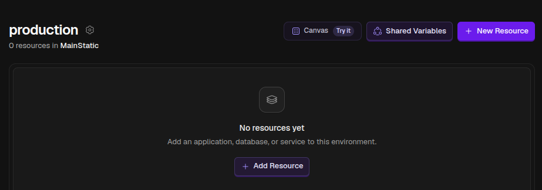
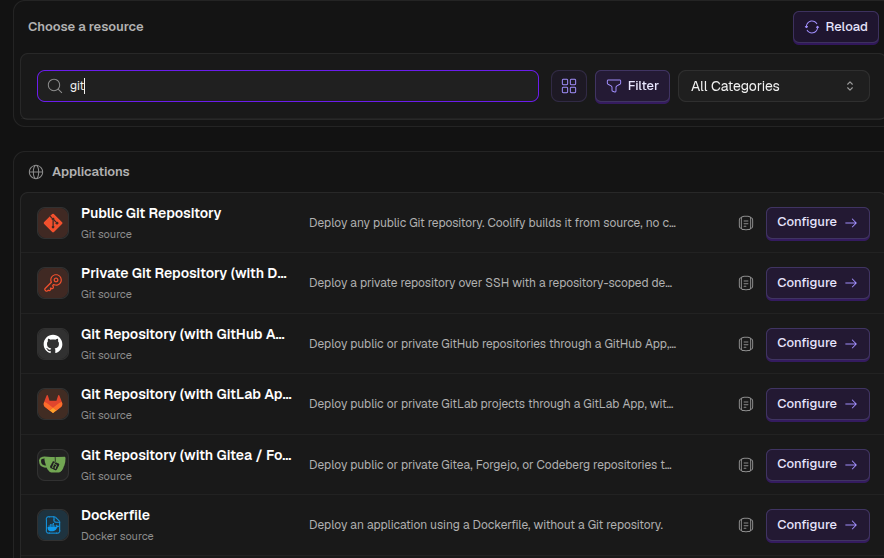
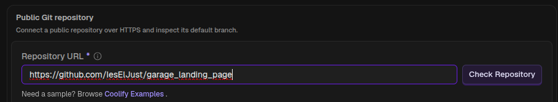
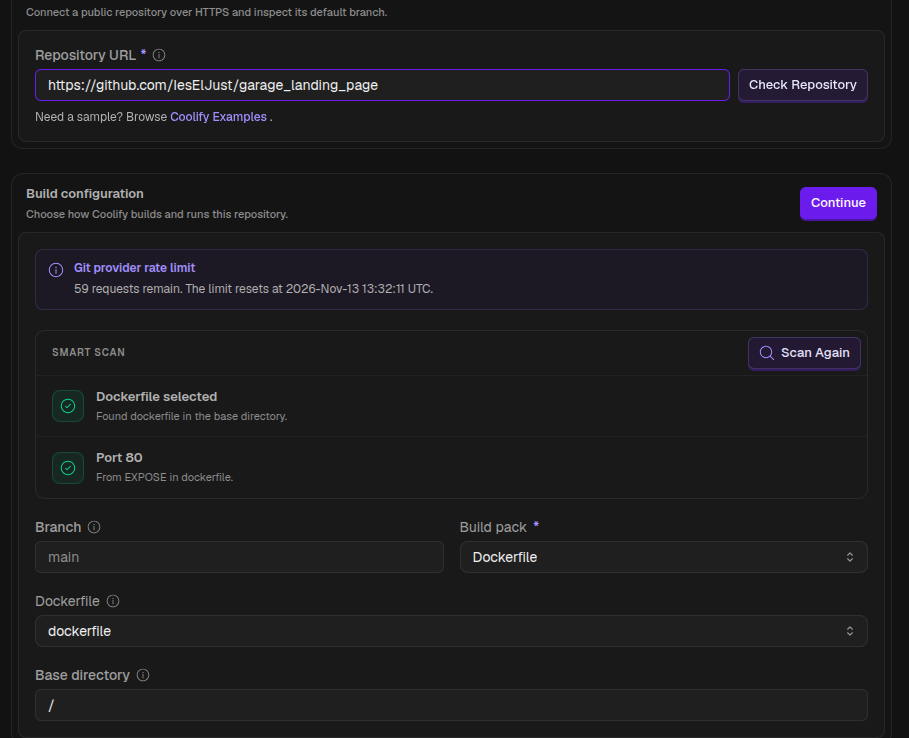
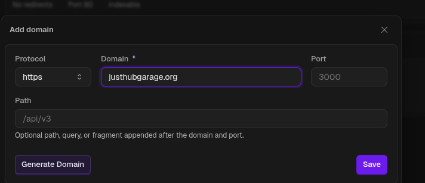
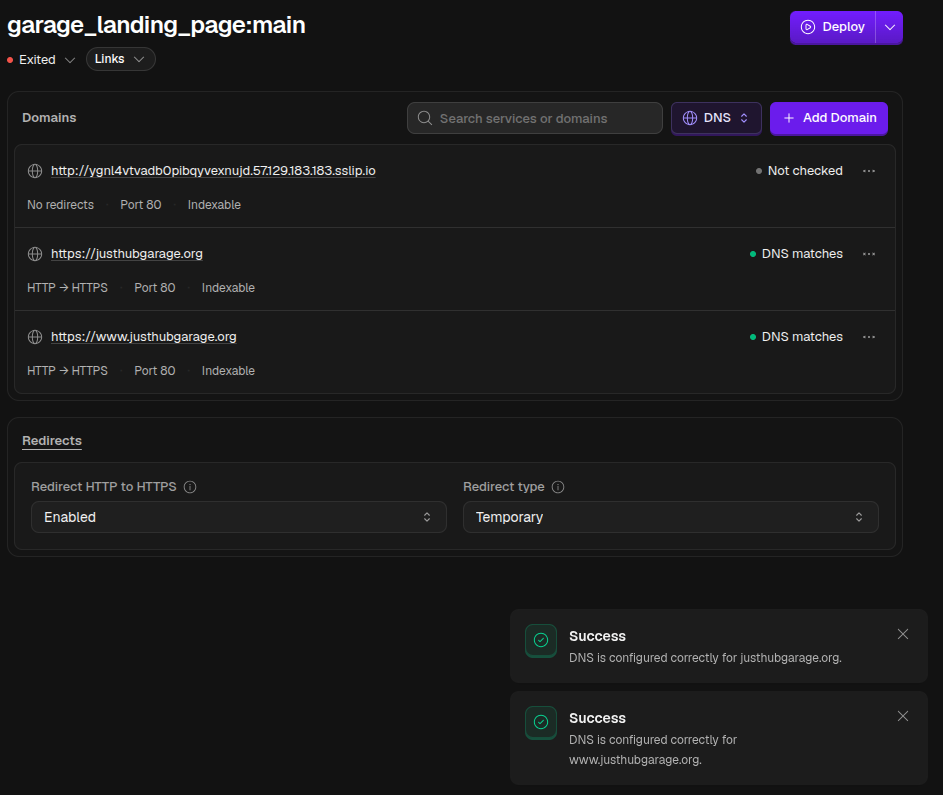
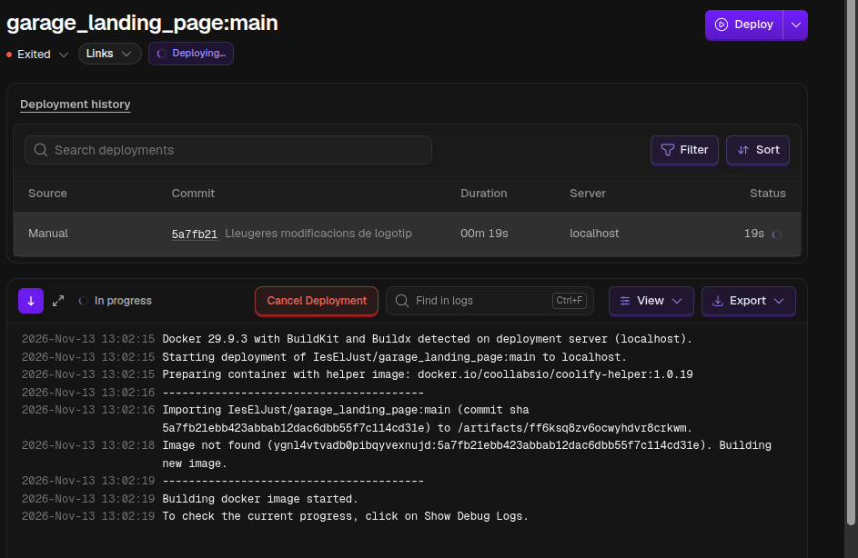
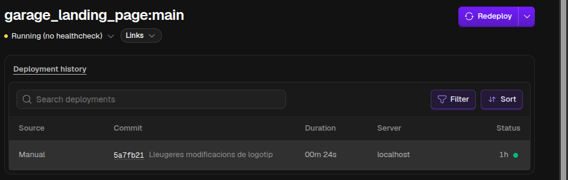

# Incorporant a coolify un lloc web estàtic

Partim d'un repositori en Github (https://github.com/IesElJust/garage_landing_page). Aquest repositori conté:

- Documentació per al lloc web principal del projecte, elaborada amb markdown i zensical
- Un dockerfile per crear una imatge amb el contingut, llesta per desplegar.

Amb un projecte creat (MainStatic), l'obrim i accedim a l'entorn de producció:

**+New Resource** per crear el recurs, i seleccionem la font Git:

Fem clic en "Public Git Repository" i afegim l'adreça del repositori:

Ara fem click en "Check Repository" i veiem les opcions de configuració que obté del servidor. Com veiem, detecta que ja tenim un dockerfile i que exposa aquest pel port 80, i que el directori base és /. 

Fem clic en "Continue".

Revisem el nom del recurs i configurem els dominis.

Per una banda, des de OVH, caldrà configurar les adreces IP proporcionades per coolify (contactem amb els administradors).

Per a això des de OVH: Web Cloud → Dominis → el teu domini → Zona DNS. Crea o modifica aquests registres:

   | Tipus | Subdomini | Destinació |
   |---|---|---|
   | A | buit —domini principal— | IP Proporcionada |
   | A | www | IP Proporcionada |

Després modifiquem la configuració de coolify:

I fem clic en Deploy

Amb això ja tenim disponible la web del Justhub Garage.