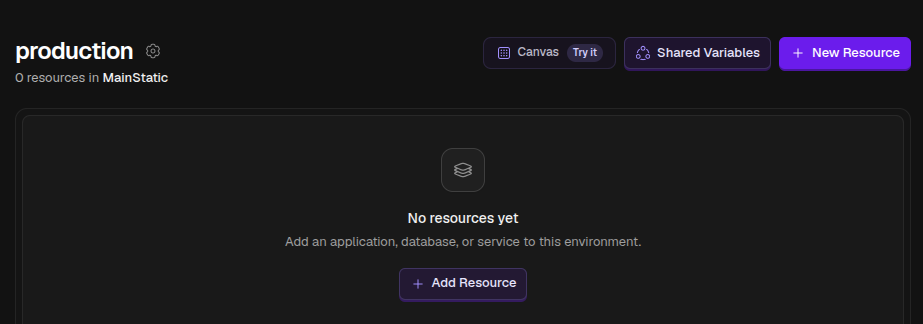
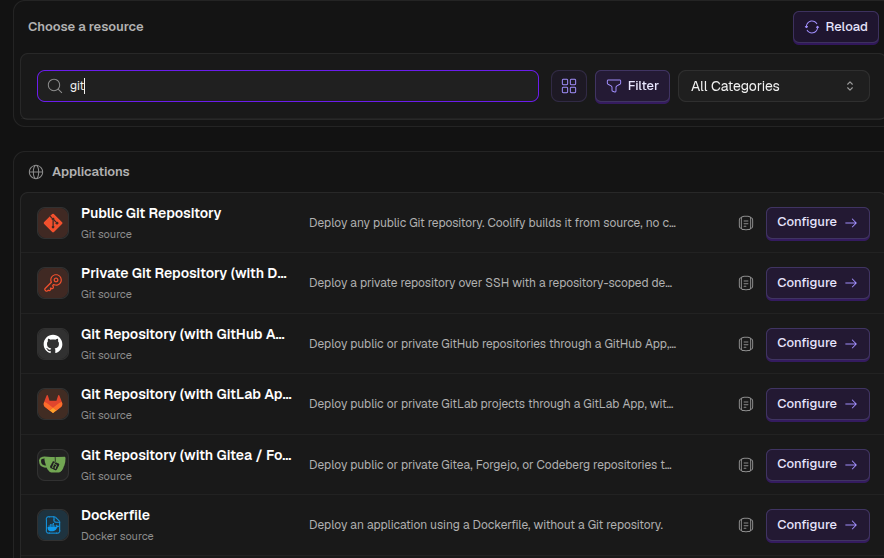
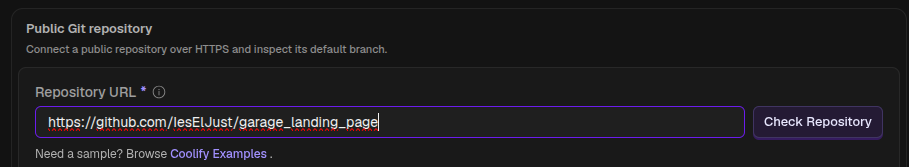
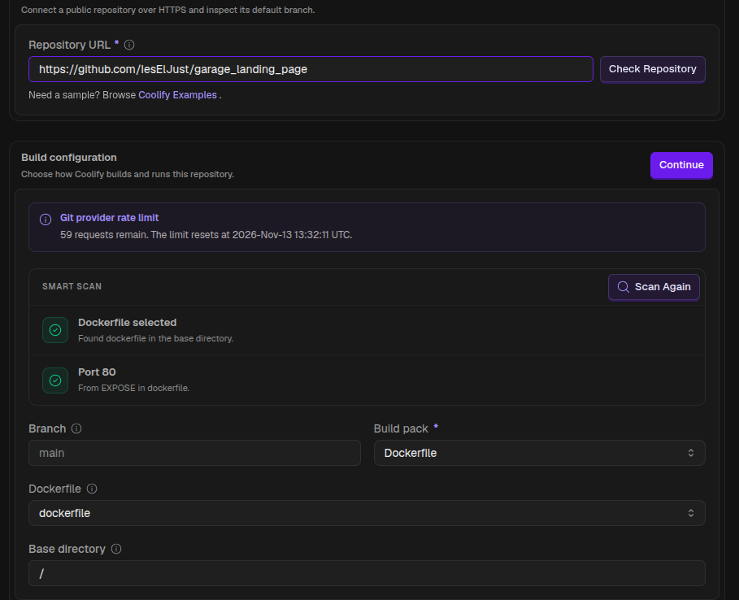
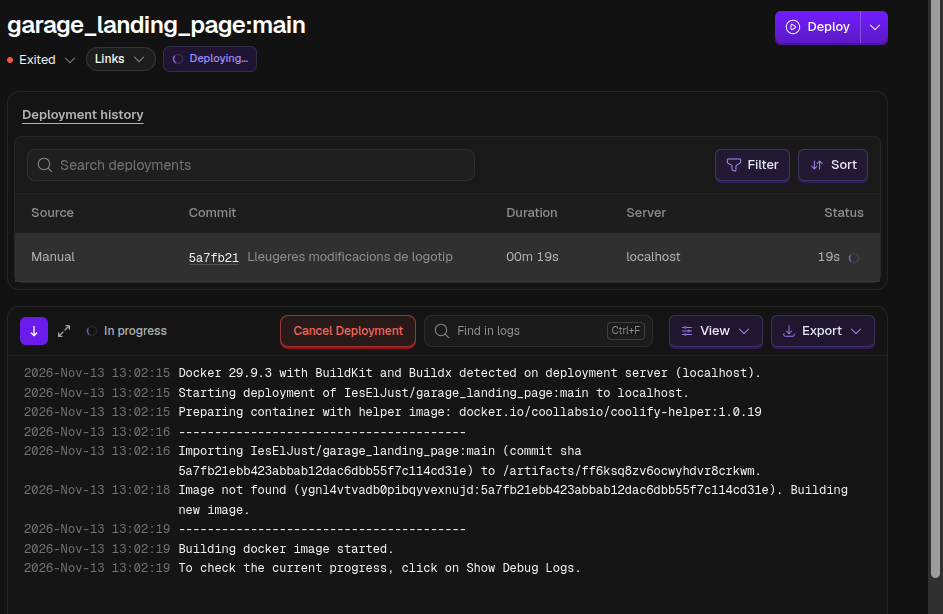
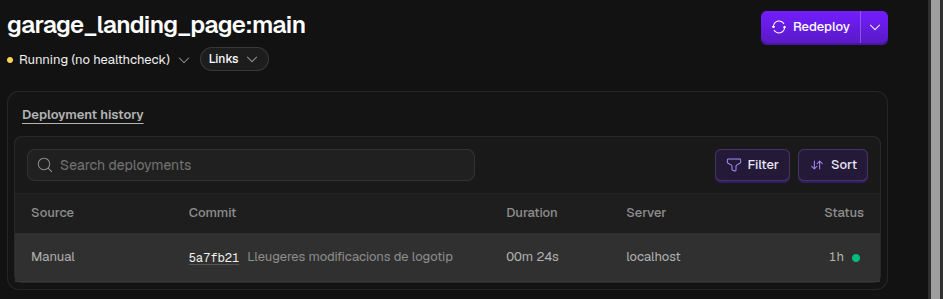

# Desplegar Zensical des de GitHub

Publicarem el web de **JustHub Garage** amb el procés real de les captures: repositori públic [IesElJust/garage_landing_page](https://github.com/IesElJust/garage_landing_page), branca `main`, projecte `MainStatic` i entorn `production`.

Substitueix aquests noms pels del teu projecte. Coolify descarregarà el codi, generarà el web amb Zensical i posarà en marxa Nginx. No cal pujar `site/` a GitHub ni copiar fitxers al VPS.

## 1. Prepara el repositori

Segueix [la preparació i prova local](preparar-zensical.md). Comprova que els documents, la configuració i el Dockerfile estan pujats a la branca que desplegaràs. En aquest exemple, el fitxer es diu **`dockerfile` en minúscules**.

## 2. Obri el projecte i l’entorn

Entra al panell amb el teu compte i selecciona el projecte assignat. En l’exemple obrim `MainStatic` i l’entorn `production`.



Si no tens projecte, demana’n un o crea’l si el teu rol ho permet. No cal utilitzar el nom de l’exemple.

## 3. Crea el recurs des de Git

Prem **+ New Resource**, escriu `git` al cercador i prem **Configure** en **Public Git Repository**.



!!! note "Quina font triem?"

    Aquest repositori és públic. Per a un de privat necessites una integració Git o una clau de desplegament autoritzada. L’opció **Dockerfile** d’aquest selector permet treballar sense Git; ací triem Git perquè també necessitem els documents del repositori.

## 4. Connecta el repositori

Introdueix la URL a **Repository URL** i prem **Check Repository**:

```text
https://github.com/IesElJust/garage_landing_page
```



## 5. Revisa la configuració detectada

**Smart Scan** detecta el `dockerfile` i el port `80` declarat amb `EXPOSE`.



| Camp | Valor de l’exemple | Significat |
| --- | --- | --- |
| **Branch** | `main` | Branca de la qual s’obté el codi. |
| **Build pack** | `Dockerfile` | Mètode per construir la imatge. |
| **Dockerfile** | `dockerfile` | Fitxer d’instruccions; respecta majúscules i minúscules. |
| **Base directory** | `/` | Arrel del repositori, utilitzada com a context de construcció. |
| Port detectat | `80` | Port intern on Nginx atén les peticions. |

!!! warning "Web estàtic i mètode de construcció"

    Ací **no triem el build pack Static**: primer cal convertir Markdown en HTML. El Dockerfile executa Zensical i incorpora el resultat a Nginx. El directori base és `/`, no `/site`: aquesta carpeta es generarà durant la construcció.

Si la detecció no coincideix, revisa la branca i la ubicació del Dockerfile. Prem **Continue** amb els valors correctes. Si es demana un servidor o destinació, tria l’assignat pel centre.

## 6. Identifica l’aplicació

En **Application Details**, pots canviar **Name** i desar-lo. El nom inicial de l’exemple és `garage_landing_page:main`.

Aquest nom identifica el recurs al panell. El domini es configura a banda, en **Public access** o **Domains**. Canviar el nom no modifica el repositori ni l’adreça pública.

Revisa també que el port intern siga **80**, com el Nginx del Dockerfile.

## 7. Configura l’accés públic

Coolify pot proposar un domini generat per a proves. Per publicar amb domini propi, segueix [domini, DNS i HTTPS](dominis.md):

1. Demana a l’administració que prepare el DNS.
2. Afegeix el domini amb protocol `https` i port intern `80`.
3. Afegeix `www` només si també s’ha preparat al DNS.
4. Desa els canvis.

**Comprovació:** utilitzes els dominis assignats al teu projecte i apunten al servidor correcte. No copies el domini de l’exemple per a una altra aplicació.

## 8. Inicia el desplegament

Prem **Deploy** i obri el desplegament en curs per consultar els registres.



La captura mostra la preparació, la descàrrega de `main` i la identificació del **commit**, la revisió concreta del codi. Després comença una imatge nova perquè encara no existeix per a aquella revisió.

Durant la construcció s’executa Zensical. Després, Coolify posa en marxa el contenidor i aplica la configuració del recurs. Consulta els registres detallats si alguna fase falla.

El servidor apareix com a `localhost`: ací es refereix al servidor de desplegament de Coolify, no al teu ordinador.

## 9. Verifica el resultat

En acabar, la captura mostra **Running (no healthcheck)** i un indicador verd a l’historial.



**Running** indica que el contenidor s’executa. **No healthcheck** indica que no hi ha una comprovació de salut configurada. Cal verificar també el web:

- Obri l’adreça des de **Links** o la llista de dominis.
- Revisa portada, pàgines interiors, imatges, estils i cerca.
- Recarrega una pàgina interior per comprovar-ne l’accés directe.
- Comprova HTTPS i la variant `www`, si l’has configurada.
- Confirma que el contingut correspon al commit desplegat.

Continua amb [les actualitzacions i el diagnòstic d’errors](manteniment.md).

El tutorial segueix el registre i les captures de JustHub Garage. Consulta també la [referència de Dockerfile a Coolify](https://coolify.io/docs/applications/builds/dockerfile). Els controls poden variar segons la versió.
